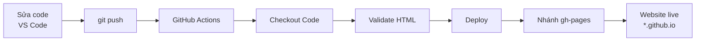

# devops-lab1-mysite

## Thông tin sinh viên
- **Họ và tên:** Trần Thu Thảo
- **MSV:** DTC235180168
- **Lớp:** KTPM-K22B
- **Website:** https://tranthuthao05.github.io/devops-lab1-mysite/

## Bước 4: So sánh DevOps vs Truyền thống

### 4.1 Bảng so sánh

| Tiêu chí | Cách THỦ CÔNG (Traditional) | Cách DEVOPS (CI/CD Pipeline) |
|---|---|---|
| **Làm sao để deploy?** | Tải file về máy, upload lên server/hosting bằng FTP hoặc thao tác tay, rồi cấu hình lại | Push code lên GitHub → pipeline tự động chạy và deploy |
| **Mất bao lâu?** | Khoảng 15-30 phút mỗi lần | Khoảng 10 giây |
| **Ai làm deploy?** | Con người (dev hoặc sysadmin) làm bằng tay | GitHub Actions (máy tự làm) |
| **Có bị sai sót không?** | Có: dễ quên file, upload nhầm, cấu hình lệch giữa các lần | Không đáng kể: pipeline chạy cùng một quy trình mỗi lần |
| **Rollback nếu lỗi?** | Tìm bản backup rồi upload lại bằng tay, dễ nhầm bản | `git revert` + push → pipeline tự deploy lại bản cũ |
| **Làm sao biết deploy thành công?** | Tự mở website kiểm tra bằng mắt | Tab Actions hiển thị ✅ hoặc ❌ |

### 4.2 Sơ đồ workflow

### 4.3 Trả lời câu hỏi

1. **DevOps workflow tự động hóa những bước nào mà cách thủ công phải làm bằng tay?**
   Build, kiểm tra (Validate HTML) và deploy đều do GitHub Actions tự thực hiện.

2. **Nếu deploy sai, làm sao quay lại phiên bản cũ?**
   Dùng `git revert <commit>` (hoặc `git reset --hard <commit>`) rồi push, pipeline tự deploy lại bản cũ.

3. **GitHub Actions tiết kiệm bao nhiêu thời gian so với thủ công?**
   Thủ công mất khoảng 15-30 phút (tải file, upload, cấu hình, kiểm tra), còn DevOps chỉ cần `git push` và chờ khoảng 10 giây.
